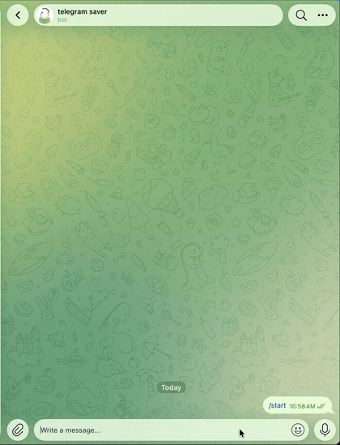

# telegram-restricted-downloader

**Telegram, Instagram, YouTube, Spotify and X downloader, as a Telegram bot.** Paste a link, get it back: Telegram messages including channels and groups that block saving and forwarding, Instagram posts and reels, YouTube videos or audio in the quality you pick, Spotify tracks matched to YouTube audio, and X videos/GIFs.

One Python file, no database, no web server.



## What it does

- 🧱 **Reads Telegram's new rich posts.** Since 2026 some channels publish block-based posts (the Instant View format). Their classic text and media fields are empty, so every other bot of this kind returns nothing. This one flattens the blocks and sends the text plus every photo and video in them.
- 📸 **Instagram posts and reels.** Every photo and video arrives as one album, caption included. Public posts work anonymously when Instagram permits it; a saved login can be used when it refuses anonymous requests.
- ▶️ **YouTube, with a menu.** Paste a link and the bot replies with one button per option, each labelled with quality, extension and size. Tap one and the file arrives, named after the video, as a playable video with a preview.
- 🎵 **Spotify tracks.** Paste a track link and get matching YouTube audio as M4A, with Spotify title, artist, album and cover art. AAC sources are kept without re-encoding; this does not download Spotify's own audio.
- ✖️ **X/Twitter videos and GIFs.** All videos from the linked post arrive together, with its caption. No extra downloader dependency is needed.
- 🎬 **Keeps media as media.** Videos stay streamable with their dimensions and duration, voice notes stay voice notes, GIFs stay GIFs, captions and text formatting are preserved.
- 🔒 **Private by default.** Only the account ids you list can use it. Anyone else gets a polite refusal that shows them their own id.
- 🌍 **English and Persian replies.** Adding a language is copying one JSON file.
- 🪶 **Nothing to host but the script.** One file, no MongoDB, no Flask keep-alive, no Docker, and no separate ffmpeg to install. Works on Windows, Linux and macOS.

## Setup

1. **Python 3.11 or newer**, then `pip install -r requirements.txt`. Spotify support uses spotDL 4.6, which requires Python 3.11+. Use Python below 3.16 with the current spotDL release.
2. **A JavaScript runtime**, for YouTube and Spotify's matching audio: deno or node. YouTube signs its streams with a challenge and yt-dlp runs the solver through one of them. deno is a single `deno.exe` you can drop anywhere. See [YouTube setup](#youtube-setup) if you would rather not touch `PATH`.
3. Create an application at https://my.telegram.org to get `API_ID` and `API_HASH`, and a bot from [@BotFather](https://t.me/BotFather) to get `BOT_TOKEN`.
4. `cp .env.example .env` and fill in the values.
5. `python bot.py`. The first run asks for the phone number and login code of the fetching account, plus the two-step password if enabled. The login is saved to `user.session`, so this happens once.
6. Open your bot in Telegram, press Start, paste a link.

Telegram and Instagram need nothing beyond the pip install: ffmpeg arrives with it via `imageio-ffmpeg`, which places a binary in `site-packages`. An ffmpeg already on `PATH` is used instead when there is one.

## Supported links

```
https://t.me/channel/123                 public channel or group
https://t.me/c/1234567890/123            private channel or group
https://t.me/c/1234567890/5/123          topic link
https://t.me/b/botname/123               a chat with a bot
https://t.me/channel/123?single          single item of an album
https://www.instagram.com/p/CODE/        Instagram post, all photos and videos
https://www.instagram.com/reel/CODE/     Instagram reel
https://www.youtube.com/watch?v=ID        YouTube video, pick quality or audio
https://youtu.be/ID                       same, short form
https://www.youtube.com/shorts/ID         same, Shorts
https://www.youtube.com/live/ID           same, a past live stream
https://open.spotify.com/track/TRACKID    Spotify track, matching audio from YouTube
https://open.spotify.com/intl-en/track/TRACKID  same, locale-prefixed link
spotify:track:TRACKID                    same, Spotify URI
https://x.com/username/status/123         X post, all videos and GIFs
https://twitter.com/username/status/123   same, legacy Twitter link
```

Instagram stories and highlights are not supported. Instagram may limit downloads even for public posts. See [Instagram login](#instagram-login) if it returns `401 Unauthorized` or *"Please wait a few minutes before you try again."*

Playlists are not supported on YouTube: only the single video in the link is offered.

## Spotify

Send a single track link or `spotify:track:ID` URI. spotDL reads its metadata, finds matching audio on YouTube Music, and embeds the title, artist, album and artwork. The bot sends an M4A with Telegram's inline audio player. Matching can fail or find a different recording; it does not guarantee Spotify's original audio.

For speed and lower CPU use, the bot requests AAC/M4A at its source bitrate and skips conversion when that format is available. It reuses one spotDL matcher, disables lyrics searches and processes one download at a time. It does not upscale to 320 kbps. If AAC is unavailable, yt-dlp converts the available audio to M4A. All audio downloads stay in the request folder so failed transfers are cleaned up too.

Spotify requires no additional settings. The existing `YT_COOKIES`, `YT_CLIENTS` and `YT_JS_RUNTIME` settings apply to its YouTube requests too. Install updated requirements and restart the bot after upgrading. Spotify album, playlist, artist and podcast links are not supported.

## X / Twitter

Send an `x.com` or `twitter.com` post link. The bot downloads every video/GIF in that post at the best available combined MP4 quality, with no format-menu round trip or video conversion. It sends multiple videos as an album. Photo-only posts, text-only posts, profiles and Spaces are not supported.

Public posts are attempted without login. For a post requiring access from your own account, set `X_COOKIES` to an exported cookies file or a browser name, using the same syntax as `YT_COOKIES`, then restart:

```env
X_COOKIES=firefox
# Or: X_COOKIES=C:\\path\\to\\x-cookies.txt
```

X and YouTube cookies are configured separately. The signed-in account must have access to the post; deleted or unavailable posts cannot be recovered.

## Instagram login

The bot uses anonymous requests by default. If Instagram refuses them, create a saved session on the machine running the bot, using the same Python environment as the bot:

```sh
python -m instaloader --login YOUR_USERNAME
```

Replace `YOUR_USERNAME` with your Instagram username. Follow the password and two-factor prompts, then add this to `.env` and restart the bot:

```env
IG_USERNAME=YOUR_USERNAME
```

The bot reads Instaloader's saved session and uses its authenticated media endpoint instead of the GraphQL query that returned the error. It does not ask for your Instagram password in Telegram or store it in `.env`. Private posts require the signed-in account to have access.

Leave `IG_SESSIONFILE` empty to use Instaloader's default session location. For a bot running under a different OS account, copy your own session file to the bot's machine and set `IG_SESSIONFILE` to its path. Relative paths are resolved beside `bot.py`. Session files grant account access; keep them private and out of version control (names ending in `.session` are already ignored).

If command-line login fails, Instaloader also supports [importing a browser session](https://instaloader.github.io/cli-options.html#login-download-private-profiles). For example, with Instagram signed in to Firefox on that machine:

```sh
python -m pip install browser-cookie3
python -m instaloader --load-cookies firefox
```

Set `IG_USERNAME` to the username reported by that command. Instagram can still restrict an account or network address; pause requests and complete any checkpoint in the browser before renewing the session. The bot stops on HTTP 401/403/429 instead of repeatedly retrying a refused request.

## YouTube

### The menu

Paste a link and the bot answers with one button per option:

```
Rick Astley - Never Gonna Give You Up  ·  3:33

🎬 1080p · mp4 · 80.5 MB
🎬 720p  · mp4 · 28.5 MB
🎵 audio · mp3 320kbps · 8.1 MB
🎵 audio · mp3 192kbps · 4.9 MB
🎵 audio · mp3 128kbps · 3.3 MB
```

Every video option is `.mp4`, made by pairing YouTube's H.264 stream with its best m4a audio and muxing them, because mp4 is the one container every phone and browser plays. Audio options are that same best audio re-encoded to mp3.

The sizes are real figures from YouTube's own metadata rather than an estimate, so what a button promises is what lands in the chat, and the delivered file keeps the name of the video.

A video button sends the result as a video, with its thumbnail and a play button, so it streams in the chat instead of arriving as a file to open. An audio button sends a document, which is what keeps `mp3` as the extension rather than Telegram renaming it. Either way the title rides along as the caption.

### Settings

All optional. Defaults work; nothing here needs setting unless YouTube is refusing you.

| Setting | Default | What it does |
| --- | --- | --- |
| `YT_MAX_H` | `1080` | Highest resolution offered as a button. `2160` adds 1440p and 4K. |
| `YT_AUDIO_KBPS` | `128,192,320` | Audio bitrates, one button each. Trim the list to taste. |
| `YT_COOKIES` | *(empty)* | Cookies for YouTube's bot check. A browser name, or a path to `cookies.txt`. |
| `YT_CLIENTS` | `default,-tv_downgraded,web_embedded` | Which YouTube players yt-dlp may ask. |
| `YT_JS_RUNTIME` | *(empty)* | Full path to `deno.exe` or `node.exe`, for when neither is on `PATH`. |

Two notes on the audio tiers. A tier above what a video's own audio provides is still encoded at that bitrate, so it plays everywhere but adds no detail over the source. And a `1280x720` button at 36 minutes is already around 600 MB, while 1080p is over 1 GB — Telegram's ceiling for what a bot may upload is 2 GB, so on long videos a lower `YT_MAX_H` is the difference between working and failing at the upload step.

### YouTube setup

Two things beyond the pip install, both for YouTube only.

**The challenge solver.** `requirements.txt` asks for `yt-dlp[default]`, which pulls `yt-dlp-ejs`. Those are the solver scripts, and they are not part of a plain `yt-dlp` install. Without them YouTube's "n challenge" fails, every stream arrives without a URL, and yt-dlp offers only storyboard images — which it reports as *"Requested format is not available"*.

**A JavaScript runtime.** Install [deno](https://github.com/denoland/deno/releases) (a single file, no installer) or node. If adding it to `PATH` is awkward on Windows, name it instead:

```
YT_JS_RUNTIME=C:\Users\You\Downloads\deno.exe
```

### When YouTube refuses the address

YouTube regularly challenges addresses that look automated with *"Sign in to confirm you're not a bot"*, and when it does, no format is listed and the menu never appears. This keys on the network address, not on the bot. A home connection usually gets through; a shared server or a fresh VPS address is the worst case.

The way past it is cookies from a signed-in browser:

```
YT_COOKIES=chrome
```

`edge`, `firefox`, `brave`, `chromium`, `opera`, `safari` and `vivaldi` also work, as does `firefox:container` for a named container.

**On Windows, prefer a `cookies.txt` file.** Windows seals Chromium cookies with DPAPI, which only opens for the same Windows account that owns the browser profile, so a bot running as a service or another user fails with *"Failed to decrypt with DPAPI"* whatever browser you name. Firefox is unaffected. A `cookies.txt` needs no decryption at all: install the *Get cookies.txt LOCALLY* extension, open youtube.com, export, and point at the file.

```
YT_COOKIES=C:\path\to\cookies.txt
```

Those are session cookies and they expire within hours. Expect to re-export now and then. Leaving `YT_COOKIES` empty is a legitimate setup too: YouTube then decides per video rather than every link failing at once when a session dies.

## Troubleshooting

The bot turns the failures it knows about into plain sentences rather than passing yt-dlp's last error line through. If you see one of these, here is what it meant.

| What you see | What is actually wrong |
| --- | --- |
| *"Sign in to confirm you're not a bot"* | YouTube is challenging the address. Set `YT_COOKIES`. |
| Instagram `401 Unauthorized` / *"Please wait a few minutes"* | Instagram refused the request. Pause downloads and configure a saved session via `IG_USERNAME`; see [Instagram login](#instagram-login). If already configured, check the account in a browser and renew its session. |
| *"Failed to decrypt with DPAPI"* | A Chromium browser was named on Windows. Export a `cookies.txt`, or use Firefox. |
| *"The page needs to be reloaded"* | With cookies set, yt-dlp asks for a player YouTube is refusing ([yt-dlp#16212](https://github.com/yt-dlp/yt-dlp/issues/16212), [#17389](https://github.com/yt-dlp/yt-dlp/issues/17389)). Adjust `YT_CLIENTS`. |
| *"Requested format is not available"* | The challenge solver is missing, or there is no JS runtime. Run `pip install -U "yt-dlp[default]"` and check `YT_JS_RUNTIME`. |
| Buttons appear, tapping does nothing | yt-dlp is too old for YouTube's current player rules. `pip install -U --pre yt-dlp`. |
| Only some videos work | Not a fault. YouTube's challenge is per video and driven by how much traffic it has seen. |

## Configuration

Everything lives in `.env` next to `bot.py`. See `.env.example` for the full list.

| Setting | Default | What it does |
| --- | --- | --- |
| `API_ID`, `API_HASH` | — | From my.telegram.org. Required. |
| `BOT_TOKEN` | — | From @BotFather. Required. |
| `OWNER` | *(empty)* | Comma-separated Telegram ids allowed to use the bot. Empty means only the account you logged in with. Anyone not on the list who messages the bot is shown their own id, which is the easy way to collect ids from people you want to add. |
| `BOT_LANG` | `en` | Reply language, a file name in `i18n/`. |
| `IG_USERNAME` | *(empty)* | Instagram username for a session created with `python -m instaloader --login USERNAME`. Empty means anonymous requests. |
| `IG_SESSIONFILE` | *(empty)* | Saved Instagram session file. Empty uses Instaloader's default location; relative paths start beside `bot.py`. |
| `X_COOKIES` | *(empty)* | X/Twitter cookies: browser name or exported cookies file. Separate from `YT_COOKIES`. |

## Keep it running

Linux, quick and dirty:

```
nohup python bot.py >> bot.log 2>&1 &
```

Windows, as a task that starts at boot (asks for your password once):

```
schtasks /create /tn tgsave /sc onstart /ru %USERNAME% /rp * /tr "cmd /c cd /d C:\path\to\repo && python bot.py >> bot.log 2>&1"
```

## Update

```
git pull
pip install -r requirements.txt
```

then restart the process. Sessions and `.env` are untouched.

## Language

Replies are English by default. Set `BOT_LANG=fa` in `.env` for Persian. To add a language, copy `i18n/en.json` to `i18n/xx.json`, translate the values, and set `BOT_LANG=xx`. Pull requests with new languages are welcome.

## When something is not supported

If a Telegram post type the bot does not understand comes back, it replies with a dump of the raw message. Open an issue with that dump and the link type.

## Test

```
python test_bot.py
python test_downloaders.py
```

Plain asserts, no test framework, and it needs nothing from the network. Instagram photos, reels and mixed albums are checked with a saved test session and simulated network responses, including refused requests. The YouTube format menu is built from a captured format list so the size labels, codec preference and height cap can all be checked offline.

Spotify/X checks cover link validation, client reuse, multi-video posts and upload-failure cleanup. A short generated AAC fixture exercises the real yt-dlp download/postprocessing and spotDL metadata pipeline across separate worker threads, verifies its tags and confirms AAC is not re-encoded. Only network operations are replaced.

`IG_TEST=<shortcode> python test_bot.py` additionally downloads that Instagram post for real.

## How it works

Two Telethon clients run in one process. Your own account (a user session) fetches the Telegram message and, if needed, downloads the media. The bot re-sends it to you. Bots cannot read arbitrary chats or copy out of protected ones, which is why the user session is required. For private chats the fetching account must already be a member.

Instagram posts are fetched with instaloader: anonymously by default, or through its authenticated media endpoint when `IG_USERNAME` names a saved session. YouTube links are read with yt-dlp, which needs no login unless YouTube's challenge forces the question.

Spotify matching and tagging use spotDL; X uses the existing yt-dlp library. Blocking downloads run off the bot's event loop. A shared lock permits one active job, and unique Spotify/X request directories are removed after delivery or upload failure.

The YouTube menu is the only stateful part: an open menu is held in memory under a random token, the buttons carry only that token, and a choice is good once. Formats are selected by a height-bound filter rather than by id, so a format list that differs from the one behind the menu still resolves to something playable.

## Notes

Use your own API credentials and your own account. Respect the wishes of content owners and the terms of Telegram, Instagram and YouTube. This tool exists for personal archiving of content you already have access to.

MIT license.
