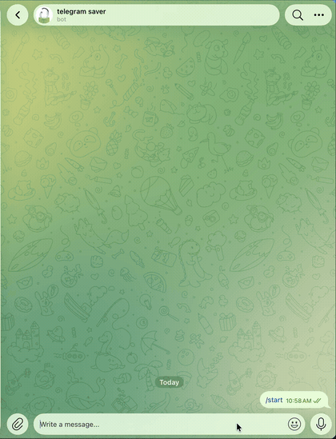

# telegram-restricted-downloader

**Instagram, YouTube and Telegram restricted-content downloader, as a Telegram bot.** Paste a link, get the post back: Telegram messages, including channels and groups that block saving and forwarding, Instagram posts and reels, and YouTube videos or audio in the quality you pick.

One Python file, ~290 lines, no database, no web server.



## Why another "save restricted content" bot

- 🧱 **Reads Telegram's new rich posts.** Since 2026 some channels publish block-based posts (the Instant View format). Their classic text and media fields are empty, so every other bot of this kind returns nothing. This one flattens the blocks and sends the text plus every photo and video in them.
- 📸 **Instagram too.** Paste a post or reel link and every photo and video in it arrives as one album, caption included. No Instagram account needed for public posts.
- ▶️ **YouTube too.** Paste a video link and the bot replies with a button per option, each labelled with quality, file extension and size: `🎬 1080p · mp4 · 80.5 MB` or `🎵 audio · mp3 128kbps · 3.3 MB`. Tap one and the finished file arrives, named after the video.
- 🎬 **Keeps media as media.** Videos stay streamable with their dimensions and duration, voice notes stay voice notes, GIFs stay GIFs, captions and text formatting are preserved.
- 🔒 **Private by default.** Only the account ids you list can use it. Anyone else gets a polite refusal that shows them their own id.
- 🌍 **English and Persian replies.** Adding a language is copying one JSON file.
- 🪶 **Nothing to host but the script.** One file, no MongoDB, no Flask keep-alive, no Docker, and no separate ffmpeg to install. Works on Windows, Linux and macOS.

## How it works

Two Telethon clients run in one process. Your own account (a user session) fetches the Telegram message and, if needed, downloads the media. The bot re-sends it to you. Bots cannot read arbitrary chats or copy out of protected ones, which is why the user session is required. For private chats the fetching account must already be a member.

Instagram posts are fetched anonymously with instaloader, so no Instagram login is involved.

YouTube links are read with yt-dlp, which does not need a login. One thing does bite in practice: YouTube regularly challenges addresses that look automated with *"Sign in to confirm you're not a bot"*, and when it does, no format is listed and the menu never appears. It keys on the network address, not on the bot. A home connection usually gets through, and often clears on its own after a while; a shared server or a fresh VPS address is the worst case.

When it happens, sign in to YouTube in a browser on the machine running the bot and point the bot at it:

```
YT_COOKIES=chrome
```

`edge`, `firefox`, `brave`, `chromium`, `opera`, `safari` and `vivaldi` also work, as does `firefox:container` for a named container, and a path to an exported `cookies.txt`. Leaving it empty is fine as long as YouTube is not challenging you.

On Windows, prefer a `cookies.txt` file over a Chromium browser. Windows seals Chromium cookies with DPAPI, which only opens for the same Windows account that owns the browser profile, so a bot started as a service or as another user gets `Failed to decrypt with DPAPI`. A `cookies.txt` needs no decryption at all: install the *Get cookies.txt LOCALLY* extension, open youtube.com, export from the extension, and set the path. Firefox is also unaffected, since it does not use DPAPI.

If a `cookies.txt` gets you *past* the bot check and then fails with *"The page needs to be reloaded"*, that is a known yt-dlp bug, not your cookies ([#16212](https://github.com/yt-dlp/yt-dlp/issues/16212), [#17389](https://github.com/yt-dlp/yt-dlp/issues/17389)): with cookies present yt-dlp asks for a player YouTube is currently refusing. `YT_CLIENTS` in `.env` controls which players are tried and already excludes that one; if a particular video still fails, try `YT_CLIENTS=default,-tv,web_embedded,android_vr`.

## Setup

1. Python 3.10 or newer, then `pip install -r requirements.txt`
2. Nothing else to install. YouTube merges the separate video and audio streams into one `.mp4` and converts audio to `.mp3`, and `requirements.txt` covers that with `imageio-ffmpeg`, which puts an ffmpeg binary inside `site-packages`. An ffmpeg already on `PATH` is used instead when there is one; installing one by hand is optional.
3. Create an application at https://my.telegram.org to get `API_ID` and `API_HASH`. Create a bot with [@BotFather](https://t.me/BotFather) to get `BOT_TOKEN`.
4. `cp .env.example .env` and fill in the values.
5. `python bot.py`. The first run asks for the phone number and login code of the fetching account, plus the two-step password if enabled. The login is saved to `user.session`, so this happens once.
6. Open your bot in Telegram, press Start, paste a link.

## Supported links

```
https://t.me/channel/123                 public channel or group
https://t.me/c/1234567890/123            private channel or group
https://t.me/c/1234567890/5/123          topic link
https://t.me/b/botname/123               a chat with a bot
https://t.me/channel/123?single          single item of an album
https://www.instagram.com/p/CODE/        Instagram post, all photos and videos
https://www.instagram.com/reel/CODE/     Instagram reel
https://www.youtube.com/watch?v=ID        YouTube video, pick quality or audio
https://youtu.be/ID                       same, short form
https://www.youtube.com/shorts/ID         same, Shorts
```

Instagram stories, highlights and private accounts are not supported. Instagram rate-limits anonymous downloads and may block a server's address for a while after too many requests, so leave a minute between links and wait if it starts failing.

## YouTube options

Paste a link and the bot answers with one button per option, each showing quality, extension and size:

```
🎬 1080p · mp4 · 80.5 MB
🎬 720p · mp4 · 28.5 MB
🎵 audio · mp3 128kbps · 3.3 MB
```

Every video option is `.mp4`, made by pairing YouTube's H.264 video stream with its best m4a audio and muxing them, because mp4 is the one container every phone and browser plays. Audio options are the same best audio, re-encoded to mp3. Sizes are real estimates from YouTube's own metadata, so what the button promises is what lands in the chat.

Two values in `.env` tune the menu:

- `YT_MAX_H` hides every resolution above the one you set. The default is `1080`; `2160` adds 1440p and 4K.
- `YT_AUDIO_KBPS` is the list of audio bitrates to offer, default `128,192,320`. A tier is hidden when the video's own audio is lower, since encoding silence up to 320 kbps wastes space without adding quality.

Playlists are not supported: only the single video in the link is offered.

## Access control

`OWNER` in `.env` is a comma-separated list of Telegram account ids allowed to use the bot. Leave it empty to allow only the account you logged in with. Anyone not on the list who messages the bot is shown their own id, which is the easy way to collect ids from the people you want to add.

## Keep it running

Linux, quick and dirty:

```
nohup python bot.py >> bot.log 2>&1 &
```

Windows, as a task that starts at boot (asks for your password once):

```
schtasks /create /tn tgsave /sc onstart /ru %USERNAME% /rp * /tr "cmd /c cd /d C:\path\to\repo && python bot.py >> bot.log 2>&1"
```

## Update

```
git pull
pip install -r requirements.txt
```

then restart the process. Sessions and `.env` are untouched.

## Language

Replies are English by default. Set `BOT_LANG=fa` in `.env` for Persian. To add a language, copy `i18n/en.json` to `i18n/xx.json`, translate the values, and set `BOT_LANG=xx`. Pull requests with new languages are welcome.

## When something is not supported

If a Telegram post type the bot does not understand comes back, it replies with a dump of the raw message. Open an issue with that dump and the link type.

## Test

```
python test_bot.py
```

`IG_TEST=<shortcode> python test_bot.py` additionally downloads that Instagram post for real.

## Notes

Use your own API credentials and your own account. Respect the wishes of content owners and the terms of Telegram, Instagram and YouTube. This tool exists for personal archiving of content you already have access to.

MIT license.
